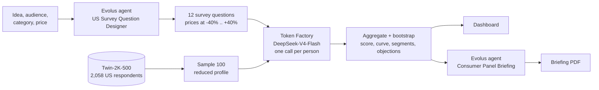
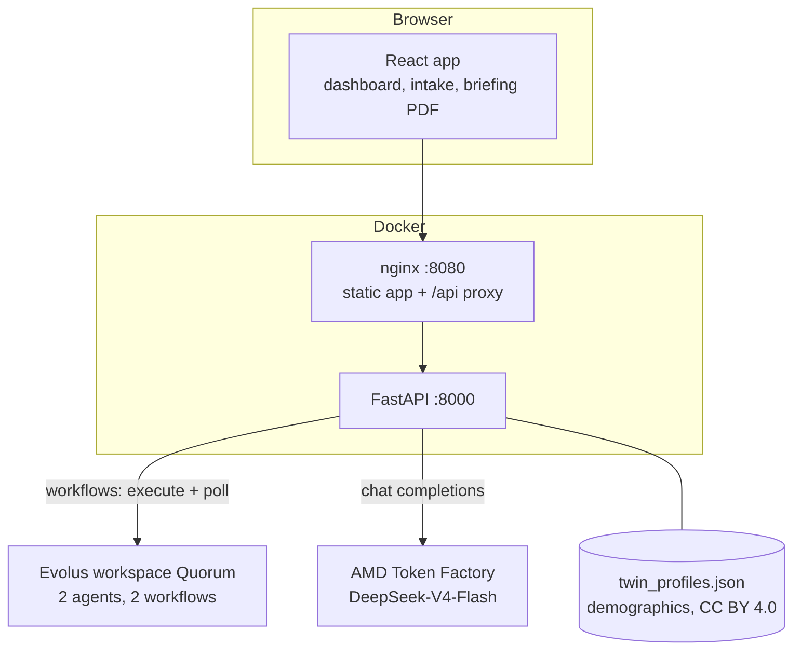

# Quorum

> Test a business idea in minutes against a synthetic panel of US consumers.

Built for the [AMD Developer Hackathon: ACT III](https://lablab.ai/ai-hackathons/amd-developer-hackathon-act-iii).
**[Watch the 1-minute demo](docs/demo.mp4)** (made with Remotion, from the real app).

## The problem

Validating a business idea usually takes weeks of surveys and interviews, and a chatbot asked "would you buy this?" gives one opinion that
represents nobody. Founders need a fast first filter that answers like *different kinds of people* do.

## What Quorum does

You describe an idea (or drop a pitch PDF), with its audience, category and price. Quorum designs a neutral survey for it, puts it to a panel of
100 simulated people built from real US survey respondents, and returns a dashboard and a one-page briefing:

- **Would buy:** the share of the panel that would buy at your price, with a bootstrap interval.
- **Viability score** with its uncertainty range.
- **Demand curve:** the share that would buy at 40% below to 40% above your price.
- **Segments:** who says yes and who does not, by age, income and political leaning.
- **Objections:** why the people who would not buy hesitate.
- **Briefing (PDF):** verdict, who buys, recommended price (computed from the demand curve), objections, competitors and next steps.

Nothing on screen is invented. Every number comes from the run, a missing value says so, and if the backend or an AI service is not available the
app shows clearly labelled example data under an **"Example data"** banner.

## A real run

Idea: *a weekly box of ready-to-cook meals for busy college students*, priced at $9. 100 respondents sampled from Twin-2K-500, each played by
DeepSeek-V4-Flash through the AMD Token Factory, the survey designed by an Evolus agent. 100 of 100 answered, in 394 seconds.
The respondents are **weighted to represent US adults** (ACS 2024: age band, sex, education, region), see "Post-stratification" below.

| Result | Weighted (shown in the app) | Unweighted |
| --- | --- | --- |
| Would buy at $9 | **27%** (95% interval 19% to 39%) | 30% (21% to 40%) |
| Would buy only at a lower price | 44% | n/a |
| Viability score | 18 (range 13 to 24) | 18 (range 14 to 24) |
| Effective sample size (Kish) | 74.8 of 100 | 100 |
| Income over $100k / under $50k | 46% / 17% | 46% / 17% |
| Main objections | price 42%, already using alternatives 17% | price 41% |

| Price | $5.4 | $7.2 | $9 | $10.8 | $12.6 |
| --- | --- | --- | --- | --- | --- |
| Would buy (weighted) | 66% | 52% | 27% | 0% | 0% |
| Would buy (unweighted) | 71% | 58% | 30% | 0% | 0% |

Weighting moves the estimates by a few points and widens the intervals; it does not change the picture. The sharp drop just above $9 is how the model
answered; we report it as measured, not as a forecast of real demand.

## How it works



1. **Survey:** the pitch goes to the *US Survey Question Designer* agent on Evolus, which returns 10 to 14 neutral questions: purchase intent at five prices, interest, value for money, trust, recommendation, current alternatives, main feature and main concern.
2. **Panel:** 100 people are sampled from Twin-2K-500 with their reduced profile (age, sex, education, family income, region). Each person gets one call with all the questions and answers as JSON `{"q1":"A",...}`. At most 5 calls run at once, with exponential backoff on HTTP 429.
3. **Post-stratification:** the 100 respondents are weighted by raking (iterative proportional fitting) to the ACS 2024 5-year shares of US adults by age band, sex, education and region (`backend/data/census_targets.json`, built from the Census Bureau API by `scripts/BuildCensusTargets.py`). Weights are kept between 0.2 and 5 and normalized; the effective sample size (Kish) is shown in the dashboard. Education targets are for adults 25+ (the only ACS population with education), and no one in a 100-person sample has less than a high school diploma, so that cell cannot be reached.
4. **Aggregation:** shares are counted from the answers; shares are weighted and every interval comes from 1,000 weighted bootstrap resamples of the respondents (2.5th to 97.5th percentile; the weights are not re-estimated inside each resample). The formulas are in the docstring of [`backend/panel.py`](backend/panel.py).
5. **Briefing:** the results and the revenue-maximizing price (worked out by the backend) go to the *Consumer Panel Briefing* agent, which writes the briefing as JSON. The JSON is cleaned (code fences removed), validated and retried once; the frontend turns it into a PDF.

## Architecture



The Evolus REST API has no "ask an agent" route, so each agent sits in a workflow with one AgentCall step; the backend runs it
(`POST /workflows/{id}/execute`, then polls `GET /workflows/{id}/executions/{executionId}`). A run takes minutes, so `/api/panel` starts a background
job that the frontend polls.

### API

| Endpoint | What it does |
| --- | --- |
| `POST /api/panel` | Starts a panel run (pitch, audience, category, price); returns a job id |
| `GET /api/panel/{jobId}` | Progress and, when done, the dashboard payload (or `example_data: true` if the run failed) |
| `POST /api/questions` | Pitch to the survey designer agent; returns the questions |
| `POST /api/briefing` | Results (+ computed `optimal_price`) to the briefing agent; returns its JSON |
| `GET /api/health` | Health check |

Interactive docs at `/docs`.

## Tech stack

| Layer | Technologies |
| --- | --- |
| Frontend | Vite 8, React 19, Tailwind CSS v4, react-router, Recharts, lucide-react, topojson with us-atlas and world-atlas (persona maps), `@react-pdf/renderer` (briefing PDF) |
| Backend | Python 3.12, FastAPI, Uvicorn, httpx (async), Pydantic, python-dotenv |
| AI services | **Evolus** (workspace *Quorum*): agents and workflows for the survey and the briefing. **AMD Token Factory**: DeepSeek-V4-Flash plays each respondent |
| Data | Twin-2K-500 (2,058 US respondents), plus GSS, ANES, Twin Mega-Study and GlobalOpinionQA for training and evaluation |
| Demo video | Remotion 4 (React), Playwright screen recording, `@remotion/motion-blur` |
| Packaging | Docker, Docker Compose, nginx |

## Project structure

```
.
├── FRONT-END/            React app (landing, /app dashboard, new simulation, history)
│   ├── components/       cards, charts, persona map, PDF upload
│   ├── lib/              API shape, example data, panel client, briefing PDF
│   ├── pages/            landing and app pages
│   └── video/            Remotion project that renders the demo (npm run demo:video)
├── backend/              FastAPI app
│   ├── panel.py          the panel: sampling, calls, aggregation, bootstrap
│   ├── token_factory.py  Token Factory client (5 at a time, backoff on 429)
│   ├── evolus.py         Evolus client: workflows, JSON cleaning and validation
│   ├── *_routes.py       /api/panel, /api/questions, /api/briefing
│   └── panel_data/       Twin demographics the panel samples from
├── scripts/              data download and training-set / panel-profile builders
├── samples/              100-row sample of the training data
├── docs/demo.mp4         demo video
└── docker-compose.yml
```

## Getting started

You need [Docker](https://docs.docker.com/get-docker/) with Compose.

1. Create the backend settings and fill them in. The file is ignored by git: never commit it.

   ```bash
   cp backend/.env.example backend/.env
   ```

   | Variable | What it is |
   | --- | --- |
   | `EVOLUS_API_KEY`, `EVOLUS_APP_ID` | Keys of the Evolus workspace that holds the two agents (survey designer, briefing writer) |
   | `EVOLUS_WORKFLOW_QUESTIONS_ID`, `EVOLUS_WORKFLOW_BRIEFING_ID` | The two Evolus workflows the backend runs, one agent each |
   | `EVOLUS_WORKSPACE_NAME` | Workspace name written in the footer of the briefing |
   | `TOKEN_FACTORY_BASE_URL`, `TOKEN_FACTORY_API_KEY`, `TOKEN_FACTORY_MODEL` | The Token Factory model that plays each respondent |
   | `PANEL_PEOPLE` (optional) | Respondents per run, 100 by default |

2. Start everything:

   ```bash
   docker compose up --build
   ```

3. Open <http://localhost:8080>. The API documentation is at <http://localhost:8000/docs>.

A run samples 100 people from Twin-2K-500, asks each of them the survey designed by the Evolus agent, and takes a few minutes. If the backend,
Evolus or the Token Factory is not available, the app shows example data under an "Example data" banner.

### Without Docker

```bash
# backend (port 8000)
python3 -m venv .venv && .venv/bin/pip install -r backend/requirements.txt
.venv/bin/python -m uvicorn backend.main:app --port 8000

# frontend (port 5173, sends /api to the backend)
cd FRONT-END && npm install && npm run dev
```

Run the panel on its own, from the command line:

```bash
.venv/bin/python -m backend.panel --pitch "A weekly box of ready-to-cook meals" --audience "College students" --category "Food" --price 9 --n 20
```

The 2,058 Twin respondents the panel draws from are in `backend/panel_data/twin_profiles.json` (demographics only, CC BY 4.0, see "Data and
licenses"). To rebuild it from the raw data: `python -I scripts/BuildPanelProfiles.py --twin-dir <Twin-2K-500>/question_catalog_and_human_response_csv`.

## Training data (for the fine-tuning step)

The panel learns from real answers given by real people, not from text generated by another model.

| Dataset | Used for |
| --- | --- |
| Twin-2K-500 | Training, validation and test: answers of 2,058 US respondents to more than 500 questions, including a pricing survey |
| Twin-2K-500 Mega-Study | Evaluation only, on consumer-style studies |
| GlobalOpinionQA | Evaluation only, at country level |
| GSS 2016-2024, ANES 2024 | Downloaded but not used yet: candidates for a second training version (economic and policy attitudes, region and state) |
| SubPOP | Not used in the current build (gated, optional) |

Each training example pairs a demographic profile and a survey question with the answer a real respondent gave. The files use TRL's conversational prompt/completion format, so the loss is computed on the answer only. Splits are made per question, so no validation or test question appears in training.

Half of the pricing products are held out in `eval_pricing.jsonl`. On those products, the same people gave the same answer two weeks later 84.4% of the time, which is the realistic ceiling for accuracy.

A 100-row sample of the training data is in [`samples/train_sample.jsonl`](samples/train_sample.jsonl).

## Roadmap

- **Fine-tune the panel on AMD Instinct (ROCm).** The panel today is a general model (DeepSeek-V4-Flash) conditioned on each respondent's profile. The next step is to fine-tune an open model with LoRA on ~186,000 Twin-2K-500 examples (already built, see below) on AMD Instinct MI300X, and compare it with the current panel on the held-out pricing set (human test-retest ceiling: 84.4%).
- State-level personas (add GSS and ANES), so the map and the "what people said" feed can be filled.
- Competitor search and A/B comparison of two versions or prices.

## Limitations

- This is a fast first filter, not a replacement for talking to real customers.
- The panel simulates US consumers: the respondents are Americans from Twin-2K-500.
- Answers come from a language model conditioned on a demographic profile; they have not yet been validated against real purchase behavior. Use the intervals, not the point estimates.
- Twin-2K-500 gives each respondent's region, not state, so there is no per-state view yet.

## Data and licenses

Four public survey datasets from Hugging Face, the General Social Survey (GSS) from NORC, and the
American National Election Studies (ANES), which must be downloaded by hand. **Raw data is not
committed to this repo**: it is downloaded on demand into `data/raw/`, which is git-ignored. Each
Hugging Face repo is pinned to a revision and each GSS file is checked against a recorded size, so
every run reproduces the same files. Sizes use decimal units (1 MB = 1,000,000 B), like the Hugging
Face UI, and cover the repo files only (not the `.cache/huggingface/` metadata the downloader writes).

| Dataset | Link | License | Revision | Size |
| --- | --- | --- | --- | --- |
| Twin-2K-500 | [LLM-Digital-Twin/Twin-2K-500](https://huggingface.co/datasets/LLM-Digital-Twin/Twin-2K-500) | CC BY 4.0 | `f883165a30` | 732.6 MB (183 files) |
| Twin-2K-500-Mega-Study | [LLM-Digital-Twin/Twin-2K-500-Mega-Study](https://huggingface.co/datasets/LLM-Digital-Twin/Twin-2K-500-Mega-Study) | Apache 2.0 | `0401b715a3` | 287.3 MB (71 files) |
| SubPOP (gated) | [jjssuh/subpop](https://huggingface.co/datasets/jjssuh/subpop) | CC BY-NC-SA 4.0 (non-commercial) | `886d78a5cb` | 34.6 MB (4 files) |
| GlobalOpinionQA | [Anthropic/llm_global_opinions](https://huggingface.co/datasets/Anthropic/llm_global_opinions) | CC BY-NC-SA 4.0 (non-commercial) | `cb28804887` | 4.7 MB (3 files) |
| GSS 1972-2024 cumulative (Stata) | [gss.norc.org](https://gss.norc.org/us/en/gss/get-the-data/stata.html) | [NORC terms and conditions](https://gss.norc.org/us/en/gss/terms-and-conditions.html) (cite, responsible use, data "as is") | Release 3a (July 2026) | 50.9 MB (2 files: `GSS_stata.zip` + 2024 codebook PDF) |
| ANES (manual download) | [electionstudies.org](https://electionstudies.org/data-center/) | ANES conditions of use (account required; research/statistical use only, no redistribution) | 2024 Time Series 2026-05-19, 2024 Pilot 2024-03-19 | 10.0 MB (2 zip files) |

Revisions are shortened here; the full commit SHAs are pinned in `scripts/DownloadData.py`.
SubPOP and GlobalOpinionQA are licensed CC BY-NC-SA 4.0 (non-commercial, share-alike). ANES may be
used for research and statistical purposes only and may not be redistributed. The GSS requires the
citation below. Check these terms before using the data in a commercial setting.

**GSS.** The script downloads the cumulative Stata file and the codebook into `GSS/` without
extracting them. NORC asks that publications and presentations using GSS data cite:

> Davern, Michael; Bautista, Rene; Freese, Jeremy; Herd, Pamela; and Morgan, Stephen L. General
> Social Survey 1972-2024. [Machine-readable data file]. Principal Investigator, Michael Davern;
> Co-Principal Investigators, Rene Bautista, Jeremy Freese, Pamela Herd, and Stephen L. Morgan.
> NORC ed. Chicago, 2026. 1 datafile and 1 codebook (2024 Release 3a).

and, in non-academic contexts: "The General Social Survey (GSS) is a project of the independent
research organization NORC at the University of Chicago, with principal funding from the National
Science Foundation."

**ANES.** Not downloaded by the script, because it requires a login: create an account on
[electionstudies.org](https://electionstudies.org/data-center/), accept the conditions of use, and
download these CSV packages by hand into `ANES/`, without extracting them:

- `anes_timeseries_2024_csv_20260519.zip` (2024 Time Series, main source, 6.5 MB)
- `anes_pilot_2024_csv_20240319.zip` (2024 Pilot Study, secondary, 3.5 MB)

The ANES files may not be redistributed, so never commit them. Citation: American National Election
Studies. 2026. ANES 2024 Time Series Study Full Release [dataset and documentation]. May 19, 2026
version. www.electionstudies.org

### Download everything

```bash
pip install huggingface_hub
python scripts/DownloadData.py
```

Options:

- `DATA_DIR=/path/to/data python scripts/DownloadData.py` — download somewhere else
  (default: `data/raw/` in the repo).
- `python scripts/DownloadData.py Twin-2K-500 GSS` — download only some datasets.

SubPOP is gated (manual approval by the dataset owner). Request access on its dataset page, then
pass your token as `HF_TOKEN` to download it. Without `HF_TOKEN` the script skips SubPOP with a
message and downloads the others (~1.08 GB including GSS).

### Build the training files

`scripts/BuildDataset.py` turns the downloaded data into the JSONL files used for fine-tuning. It
reads `Twin-2K-500/`, `Twin-2K-500-Mega-Study/` and `GlobalOpinionQA/` from the data directory
(GSS, ANES and SubPOP are not used yet) and needs pandas and pyarrow:

```bash
pip install pandas pyarrow
python -I scripts/BuildDataset.py
```

Options:

- `--data-dir /path/to/data` — read the downloads from somewhere else (default: `$DATA_DIR`, or
  `data/raw/` in the repo, the same place `DownloadData.py` writes to).
- `--out-dir /path/to/output` — write the files somewhere else (default: `<data-dir>/processed/`).
- `--format messages` — write one `messages` list per example instead of `prompt`/`completion`.

All sampling uses fixed seeds, so the same input gives the same output. Files written to the output
directory:

| File | Contents |
| --- | --- |
| `train.jsonl`, `val.jsonl`, `test.jsonl` | Twin-2K-500 examples, split per question (~80/10/10) |
| `test_partial.jsonl` | The test set with a reduced profile (age, sex, education, income, region) |
| `eval_pricing.jsonl` | The held-out pricing products, with the wave 4 answer for test-retest |
| `eval_megastudy.jsonl` | Evaluation on Twin-2K-500 Mega-Study |
| `eval_globalopinionqa.jsonl` | Country-level evaluation on GlobalOpinionQA (target is an answer distribution) |
| `tabular.csv` | The same Twin rows as a table, for a CatBoost baseline |
| `DATA.md` | Counts, splits, test-retest agreement and loading instructions |

It also rewrites the 100-row sample in `samples/train_sample.jsonl` (change it with `--sample-out`).
